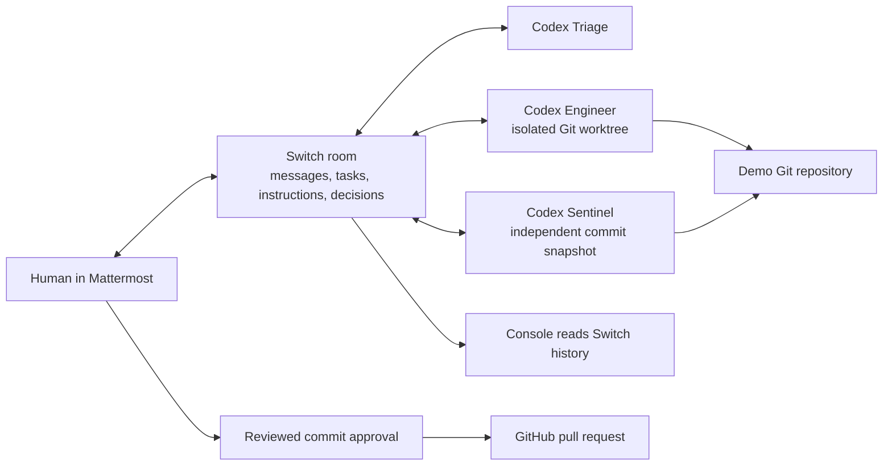

# Chainroom implementation blueprint

Locked scope: solo builder, Best Business Workflow, Mattermost, three Codex agents, GitHub. Success is one reported regression becoming an independently verified pull request after a human decision. Switch owns coordination.

## Architecture



Infrastructure: published Switch server 0.31.0, its standalone Compose contract, bundled Mattermost 11.9.0 and PostgreSQL 16. The official headless controller runs in Debian beside the existing Codex CLI; its pinned development build `0.31.1-dev.277.g2d72c57` contains the current Codex adapter and is signature-verified before installation. Source reference: Switch commit `2d72c57596506e510bcfea5bb5b267a482403ed0`. Server/controller compatibility must pass a real enrollment and response check.

Gateway runs on `localhost:8080`, Mattermost on `localhost:8065`, Switch API on `localhost:8000`. PostgreSQL uses `127.0.0.1:55432`. Use the upstream stack rather than maintaining a parallel Mattermost bot or another message bus. Do not expose this local stack publicly for the MVP.

No Chainroom database is required. A later Next.js screen will read supported Switch Gateway endpoints on the server and display incident threads and real evidence. Switch PostgreSQL remains the durable shared record. Use polling initially; add streaming only after its supported endpoint is verified. Never display fixture events as live activity.

## Build order and completion gates

| Phase | Implementation | Required proof |
| --- | --- | --- |
| 1 | Docker, pinned Switch stack, Mattermost, official controller, one Codex agent | Human test message in Mattermost gets a real Codex response in the same channel |
| 2 | Import the three-agent template with separate directories | Triage addresses Engineer through Switch; Engineer receives the task |
| 3 | Controlled TypeScript repository and isolated patch branch | Original test run fails on USDC decimals; a source patch makes it pass |
| 4 | Sentinel independently checks the exact commit | Sentinel's own test output and PASS/FAIL in the incident thread |
| 5 | Human decision and GitHub publication | Human actor, incident and reviewed SHA recorded; real PR URL returned |
| 6 | Minimal incident/evidence/approval view | Displays actual Switch history, diff, test output and decision |
| 7 | README and recorded demo | A fresh clone reproduces setup; video shows the actual workflow |

Do not build the dashboard before phase 1 succeeds. UI authentication, billing, wallets, production deployment and extra chat platforms are outside this MVP.

## Roles and permissions

Triage classifies and assigns; Engineer reproduces and fixes; Sentinel inspects an independent snapshot and reruns tests. All three use the existing Codex provider and separate native sessions. Agent names and owner-agent addressing are supported Switch settings. The version-1 template specifies provider, machine and working directory; omitting these is a provisioning error.

`auto_mode: true` uses Codex's automatic review, and `auto_approve: false` keeps permission bypass disabled. Do not confuse a separate process with a filesystem boundary. Sentinel's template forbids editing the patch, but the template alone is not an enforceable read-only sandbox. Validate the runtime's effective sandbox and ensure only its own snapshot is writable before claiming enforced role permissions. An optional stricter deployment uses Switch's per-agent Linux-user isolation; it is not required for the initial local demo.

Engineer commits only the intended source files in an isolated worktree. It does not publish, merge or deploy. Sentinel has no need for GitHub credentials. A human-owned publication command uses Git and `gh`; Switch's GitHub service connector needs a public HTTPS callback and would add unnecessary local setup work.

## Incident lifecycle

`REPORTED → TRIAGED → INVESTIGATING → FIX_PROPOSED → VERIFYING → AWAITING_APPROVAL → APPROVED/REJECTED → PR_OPEN`

Do not label a PR as merged until GitHub confirms an authorized human merge. Failed tests or a FAIL review return to the Engineer. Missing access, timeout or disconnected controller remain unresolved with their actual reason. No agent can manufacture a successful state.

Every handoff carries incident ID, original thread ID, repository, expected behavior and required evidence. Review includes the full commit SHA. A human approves with `APPROVE CR-001 <full SHA>` or rejects with `REJECT CR-001 <full SHA> <reason>` in the same thread. Agent text quoting an approval is not a human decision.

The publication gate must read Switch-authenticated message authors and the current reviewed SHA directly. It must reject an agent approval, absent review, failed tests, stale SHA, later rejection and changed patch. Bind each publication to the incident/SHA and check for an existing PR before creating one. This gate is application code, not merely a prompt; until implemented and tested, publish manually after inspecting the thread.

## Evidence contract

Each test run records `{incident, actor, base_sha, commit_sha, command, cwd, exit_code, stdout, stderr, timestamp}`. Review records `{incident, sentinel_actor, commit_sha, verdict, findings, evidence_message_ids}`. Human decisions record `{incident, human_actor, commit_sha, decision, switch_message_id, timestamp}`. Keep actual output in the thread or an attached artifact; local files are exports, not independent approval authority.

Never insert credentials into templates, messages, evidence or committed files. Generated stack passwords live in ignored mode-0600 `.env`; controller credentials live in its mode-0700 runtime directory. Avoid commands that print complete Compose configuration or environment variables. Do not reuse production repositories for the fixture.

## Controlled incident

The demo formats `75000000` atomic USDC units (`decimals=6`) as `0.000000000075`, when it should display `75`. The initial function wrongly assumes 18 decimals. The test suite checks USDC whole and fractional balances, an 18-decimal asset, zero, values above JavaScript's safe integer range and invalid metadata.

Baseline must show exactly two failing regressions and four passing tests. The Engineer should investigate the source and choose the fix itself. Sentinel should add independent execution checks for zero-decimal tokens and 36-decimal precision without editing the proposed branch. Describe this honestly as an intentionally introduced regression.

## First commands

Run from the project root. Prefix with `rtk proxy` when RTK is installed; this machine currently uses `/home/greyw0rks/ubuntu-to-debian-migration/bin/rtk proxy`.

```sh
node scripts/bootstrap.mjs
node scripts/install-controller.mjs
node scripts/prepare-demo.mjs
docker compose --project-name chainroom --env-file .env \
  -f .tools/switch-compose.yml -f deploy/chainroom.override.yml \
  --profile collab --profile gateway up -d
npm --prefix demo test
```

The final command intentionally fails on the starting demo revision. `prepare-demo.mjs` makes an independent Git repository in `.runtime/demo-repo` and captures the initial test output. If the user lacks Docker socket access, run Compose with `sudo` in their terminal. Do not disable socket permissions. Open the Gateway and sign in with the local credentials from `.env`; generate an enrollment code in Machines and enroll the controller:

```sh
.tools/controller/bin/switch-agent-controller enroll \
  --server http://127.0.0.1:8000 --code <one-time-code> \
  --name chainroom-debian --data-dir .runtime/controller
.tools/controller/bin/switch-agent-controller run --data-dir .runtime/controller
```

Leave it running. Upload `templates/connection-check.template.yaml` first, or use the prepared `setup-switch.mjs smoke` helper. Verify a classification-only message and actual Codex reply in Mattermost. Then upload `templates/chainroom.template.yaml` in Gateway Resources → Templates. Use the enrolled machine, absolute workspace root `.runtime/workspaces`, absolute repository `.runtime/demo-repo`, and the seeded Mattermost bridge. Report the controlled regression only after that connection check succeeds. Exact API payloads and provisioning must be checked against the installed server, not guessed from this blueprint. [RESUME.md](RESUME.md) records the current machine's next commands.

## Presentation and schedule

Nov 4: real Mattermost response and handoff. Nov 5: failing test → isolated fix → independent review → approved PR. Nov 6: evidence screen and failure checks. Nov 7: reproduce from README, record a two-to-three-minute demo and submit. User-supplied cutoff is Nov 7, 23:59 IST (19:29 Lagos); verify the official submission form before relying on it.

The video should show the Mattermost report, delegation, actual Git diff and test output, Sentinel's independent result, human approval and real PR. Do not record a simulated timeline as live execution. Keep the blog and social post secondary to the complete workflow.

## Verified references

- [Switch README](https://github.com/sandbox-quantum/switch)
- [Templates](https://docs.switchagents.ai/switch-rooms/administer/room-templates)
- [Agent settings](https://docs.switchagents.ai/switch-rooms/getting-started/agent-settings)
- [Codex providers](https://docs.switchagents.ai/switch-rooms/getting-started/set-up-agent-providers)
- [Self-hosting](https://docs.switchagents.ai/switch-rooms/deploy/self-host)
- [Official headless controller](https://github.com/sandbox-quantum/switch/tree/2d72c57596506e510bcfea5bb5b267a482403ed0/console/packages/agent-controller)
